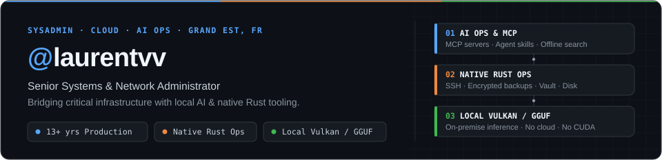
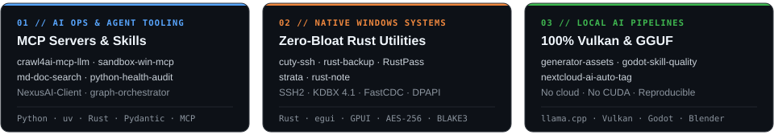

<picture>
  <source media="(prefers-color-scheme: dark)" srcset="assets/header-dark.svg" />
  <source media="(prefers-color-scheme: light)" srcset="assets/header-light.svg" />
  
</picture>

 

**13+ years** running production Linux/Windows infrastructure, networking, and automation from Grand Est, France.
I build pragmatic, self-hosted tools where systems engineering meets AI: deterministic MCP servers & agent skills, native Rust utilities for Windows, and 100% local Vulkan/GGUF pipelines with no cloud lock-in.

<picture>
  <source media="(prefers-color-scheme: dark)" srcset="assets/focus-dark.svg" />
  <source media="(prefers-color-scheme: light)" srcset="assets/focus-light.svg" />
  
</picture>

---

### AI Ops, MCP & Agent Tooling

Tools that ground AI coding agents in deterministic verification, live web/doc context, and safe execution boundaries.

| Project | Focus | Stack |
| :--- | :--- | :--- |
| [**crawl4ai-mcp-llm**](https://github.com/laurentvv/crawl4ai-mcp-llm) ([docs](https://crawl4ai-mcp-llm-doc.vercel.app)) | MCP server integrating Crawl4AI web crawling directly with AI assistants. | `Python` `MCP` `Crawl4AI` |
| [**sandbox-win-mcp**](https://github.com/laurentvv/sandbox-win-mcp) | Hardened Windows Sandbox automation for AI agents: 34 MCP tools, UIA-first input engine, in-place guest reboot, and CDP browser control. | `JavaScript` `MCP` `Windows Sandbox` |
| [**md-doc-search**](https://github.com/laurentvv/md-doc-search) | Offline full-text search over version-pinned Markdown docs — single Rust binary with IDF ranking and token-budgeted output (~40 ms on 11 MB corpora). | `Rust` `CLI` `Full-Text Search` |
| [**python-health-audit**](https://github.com/laurentvv/python-health-audit) | Read-only static audit Agent Skill (`Ruff` + `Vulture` + `Radon` + `Pylint` via `uvx`) emitting a deterministic A–F grade and 3-item action plan. | `Python` `uvx` `Agent Skill` |
| [**NexusAI-Client**](https://github.com/laurentvv/NexusAI-Client) ([docs](https://nexus-ai-client-doc.vercel.app)) | Ultra-lightweight asynchronous Python gateway unifying calls across multiple AI providers. | `Python` `AsyncIO` `uv` |
| [**graph-orchestrator-smolagents**](https://github.com/laurentvv/graph-orchestrator-smolagents) | Deterministic multi-agent graph pattern: parallel fan-out workers, Pydantic data contracts, contradictory judge node, and Python-controlled routing. | `Python` `smolagents` `Pydantic` |

---

### Native Rust Systems & Ops Tools (Windows)

Fast, memory-safe, zero-bloat desktop and CLI replacements for everyday sysadmin and workstation workflows.

| Project | Focus | Stack |
| :--- | :--- | :--- |
| [**cuty-ssh**](https://github.com/laurentvv/cuty-ssh) | Native Windows SSH2, SFTP, Telnet, Raw TCP & ConPTY connection manager with PuTTY `.ppk` v2/v3, Pageant, Bastion (`-J`), 1-click `ssh-copy-id`, and DPAPI vault. | `Rust` `egui` `SSH2` `DPAPI` |
| [**rust-backup**](https://github.com/laurentvv/rust-backup) | Encrypted, deduplicated backups to USB or SFTP with both a native desktop GUI and CLI. | `Rust` `GPUI` `AES-256-GCM` `FastCDC` `BLAKE3` |
| [**RustPass**](https://github.com/laurentvv/RustPass) | Memory-safe password manager (desktop GUI, scriptable CLI, browser proxy) supporting KDBX 4.1/3.1, Argon2id, ChaCha20, and live TOTP. | `Rust` `KDBX` `Argon2id` `TOTP` |
| [**strata**](https://github.com/laurentvv/strata) | Fast Windows disk space analyzer with live treemap, scan history, and clean-up tools. | `Rust` `Windows` |
| [**rust-note**](https://github.com/laurentvv/rust-note) | Native Notepad++-style code & text editor with tabs, syntax highlighting, regex find/replace, encodings, and function list. | `Rust` `egui` |

---

### Local AI — Vulkan & GGUF (No Cloud, No CUDA)

Reproducible local inference, media pipelines, and measured engine skills running entirely on-premise.

| Project | Focus | Stack |
| :--- | :--- | :--- |
| [**generator-assets**](https://github.com/laurentvv/generator-assets) | Headless modular local AI pipeline: 2D/3D Godot & Blender assets (Flux.1, SDXL, ESRGAN), 4K AI video (Wan 2.1/2.2, LTX-2.5), and AI music loops — 100% Vulkan/GGUF. | `Python` `Vulkan` `GGUF` `Godot` `Blender` |
| [**nextcloud-ai-auto-tag**](https://github.com/laurentvv/nextcloud-ai-auto-tag) | Auto-tags self-hosted Nextcloud photos & videos using a local vision model via `llama.cpp`; flags duplicates, blur, and screenshots — proposes, never deletes. | `Python` `llama.cpp` `Nextcloud` |
| [**godot-skill-quality**](https://github.com/laurentvv/godot-skill-quality) | Measured Agent Skills (`SKILL.md`) for Godot 4 3D rendering: lighting, AgX, SSAO/SDFGI, fog, foliage & wind shaders, post FX, and GPU perf. | `GDScript` `Godot 4` `Agent Skills` |

---

### Tech Stack

| Domain | Technologies |
| :--- | :--- |
| **Infrastructure & Cloud** | Kubernetes, Docker, Ansible, Terraform, HAProxy, Self-hosted stacks |
| **Systems & Networking** | Linux (AlmaLinux, Debian), Windows Server, SSH/SFTP, ConPTY, PowerShell |
| **Languages & UI** | Rust (`egui`, `GPUI`), Python (`uv`, FastAPI, Pydantic), PowerShell, GDScript, C++ |
| **AI & Local Inference** | MCP, Agent Skills, `llama.cpp`, Vulkan/GGUF, `smolagents`, Ollama, Local Vision & Media |

### Engineering Principles

- **Local-first & verifiable** — Self-hosted Vulkan/GGUF inference, offline version-pinned docs search, and deterministic validation contracts over blind prompting.
- **Native speed for daily ops** — Single-binary Rust utilities for SSH, encrypted backups, password vaults, and disk analysis without Electron overhead.
- **Automation as a multiplier** — Treating infrastructure, static audits, and asset pipelines as reproducible, versioned code.

---

*Browse all public projects on [github.com/laurentvv](https://github.com/laurentvv?tab=repositories).*
